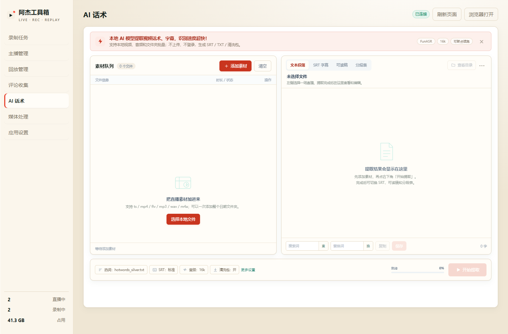
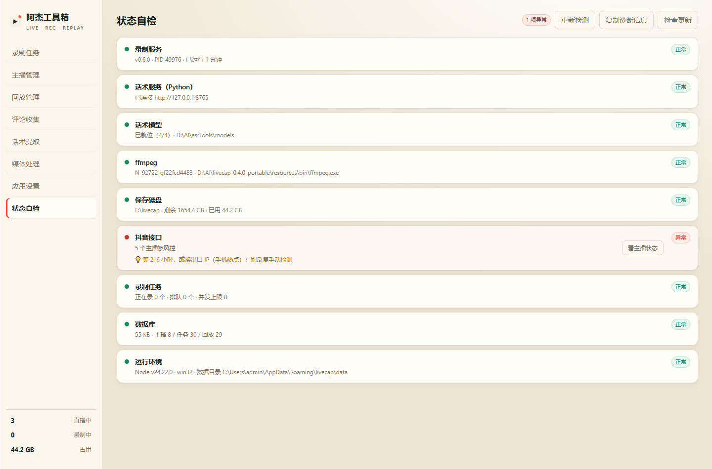

# 阿杰工具箱

抖音直播**批量录制** + **评论收集** + **话术提取**，全部在本机跑，不上传任何数据。

> 当前版本：0.6.0 · Windows 10/11 64 位



---

## 一、下载与安装（3 步）

### 1. 下载

**国内用户建议用加速链接**（GitHub 直连经常打不开，实测国内访问超时）：

```
https://ghfast.top/https://github.com/YouM-BooMBooM/ajie-toolbox/releases/download/v0.6.0/AJ-Toolbox-0.6.0-green.zip
```

实测速度约 0.8 MB/s，整包 180 MB 大概 4 分钟。

能正常访问 GitHub 的话，也可以到 [Releases](../../releases/latest) 页面直接下：

```
AJ-Toolbox-x.y.z-green.zip    约 180 MB
```

> 加速链接里的版本号要跟你要下的版本对上；新版出来时把 `v0.6.0` 换成对应的 tag 即可。

### 2. 解压

解压到**任意目录**，例如：

```
D:\软件\阿杰工具箱\
```

⚠️ **不要**解压到 `C:\Program Files`（Windows 权限保护会导致录制写不进去）。

### 3. 双击 `安装.bat`

会自动创建：桌面快捷方式、开始菜单入口、卸载入口。

看到这个就算装好了：

```
[√] 桌面快捷方式已创建
[√] 开始菜单项已创建
```

**首次打开可能提示「Windows 已保护你的电脑」** → 点「更多信息」→「仍要运行」。
（程序没有买代码签名证书，不是病毒。）

---

## 二、第一次使用

### 录制：什么都不用配

打开就是「录制任务」页，点「+ 添加主播」，粘贴直播间地址：

```
https://live.douyin.com/123456789
```

开播后自动开始录，录完自动转成 MP4 归档：

```
<保存目录>\<主播名>\<日期>\<标题>.mp4
```

默认保存在 `%USERPROFILE%\Videos\livecap`，可以在「应用设置」改成 `E:\livecap` 这种大盘。

### 话术提取：第一次要点一下下载模型

进「话术提取」页 → 如果显示「话术服务还没准备好」→ 点：

```
一键下载模型（约 1.6GB · 魔搭）
```

从魔搭（ModelScope）直接下载，**约 80 秒**（实测 1.63GB / 77 秒）。下完自动重启服务，不用退出程序。

> 没有 NVIDIA 显卡也能用，只是识别慢（CPU 大约慢 5–10 倍）。

---

## 三、功能一览



| 模块 | 干什么 |
|---|---|
| **录制任务** | 批量监控主播，开播自动录，断流自动重连续录 |
| **主播管理** | 添加/批量导入主播，看在线人数、开播状态、历史场次 |
| **回放管理** | 按主播和日期分组的录像库，播放、转码、导出、看弹幕评论 |
| **评论收集** | 按主播聚合评论，自动区分「正常 / 福袋口令 / 刷屏」，导出 CSV/TXT |
| **话术提取** | 本地 ASR 把直播转成文字，出 SRT 字幕 + 纯文本 |
| **状态自检** | 一屏看服务/模型/磁盘/风控是否正常，异常项可点进去处理 |

---

## 四、常见问题

### 提示「抖音接口被风控」

抖音对频繁访问的 IP 会返回验证码页面，表现是主播检测失败、起不了录。

**正确做法**：

- 等 2–6 小时再试
- 或者换个出口 IP（手机热点）
- **不要**反复手动点「立即检测」，越点封得越久

本工具不会破解验证码，这是故意不做的。

### 录制 3–4 小时后断了

抖音的拉流地址带过期时间，到点会失效。程序有看门狗：90 秒没数据增长就重新解析地址接着录，同一条录像不会断成两个文件。

### 磁盘满了

「应用设置」里可以设「最低剩余空间」，低于阈值时不再起新录制。
也可以设「保留天数」（默认 60 天）和「容量上限」，超了自动清理最旧的。

### 数据存在哪？怎么备份？

```
%APPDATA%\livecap\data\db.json     主播/任务/回放记录/设置（唯一状态源）
%APPDATA%\livecap\data\comments\   评论库
<保存目录>\                         录像文件
```

备份 = 复制 `db.json` + 保存目录。录像靠 db 里的路径引用，所以改保存目录不影响旧录像播放。

### 卸载

运行目录里的 `卸载.bat`：删快捷方式、清开机自启，**不删录像**。

彻底清理再手动删 `%APPDATA%\livecap`（会丢配置和历史记录）。

---

## 五、更新

打开「状态自检」→ 点「检查更新」。

有新版本会提示，点「去下载」跳到 Releases 页面；下载新 zip 覆盖解压即可（`db.json` 和录像都不受影响）。

---

## 六、系统要求

| 项 | 要求 |
|---|---|
| 系统 | Windows 10/11 64 位 |
| 磁盘 | 安装约 400 MB + 录像空间（一小时直播约 0.5–1.5 GB） |
| 网络 | 能访问抖音；下载话术模型需要能访问 modelscope.cn |
| 显卡 | 话术提取**推荐** NVIDIA（6GB 显存以上），没有也能用 CPU |

---

## 七、说明

- 全部本地运行，不收集任何使用数据
- 不破解验证码、不修改系统代理、不注入抖音客户端
- 抖音风控策略随时可能变化，工具会尽量兼容但不保证永久可用

有问题欢迎提 [Issue](../../issues)。
